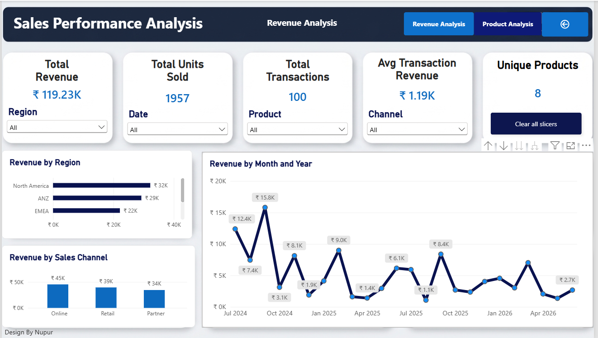

# 📊 Sales Performance Analysis

**An end-to-end data analytics project using Python, SQL, and Power BI to analyse sales performance across products, regions, sales channels, and time periods.**
**Dashboard**

### Project Overview
.png)

### Revenue Analysis Dashboard


### Product Analysis Dashboard


## 📌 Project Overview

This project analyses sales transaction data to understand business performance and generate meaningful business insights.

The analysis uses Python, Pandas, MySQL, and Power BI to explore revenue trends, product performance, regional contributions, and sales channel performance.

An interactive Power BI dashboard was developed to help stakeholders explore sales KPIs and compare performance through filters and interactive navigation.

## 🎯 Business Objectives

- Identify products generating the highest revenue.
- Analyse units sold by each product.
- Compare revenue across different regions.
- Evaluate sales performance across different channels.
- Identify high- and low-performing months.
- Calculate regional contribution to total revenue.
- Convert analytical findings into business recommendations.

## 📁 Dataset Information

The dataset contains **100 sales transactions and 7 columns**.

| Column | Description |
|---|---|
| date | Transaction date |
| region | Sales region |
| product | Product name |
| channel | Sales channel |
| units | Number of units sold |
| unit_price | Price per unit |
| revenue | Total transaction revenue |

### Data Quality Checks

- Checked for missing values.
- Checked for duplicate records.
- Validated revenue using `units × unit_price`.
- Checked for zero and negative values in units, unit price, and revenue.

## 🛠️ Tools & Technologies

| Tool | Purpose |
|---|---|
| Excel | Data inspection |
| Python | Data analysis |
| Pandas | Data manipulation and aggregation |
| MySQL | SQL-based business analysis |
| Power BI | Interactive dashboard and data visualization |
| GitHub | Project documentation and version control |

## 📈 Key Performance Indicators

| KPI | Result |
|---|---:|
| Total Revenue | ₹119,231.42 |
| Total Units Sold | 1,957 |
| Total Transactions | 100 |
| Average Transaction Revenue | ₹1,192.31 |
| Unique Products | 8 |

## 📊 Power BI Dashboard

An interactive Power BI report was developed with a project overview landing page and an interactive sales dashboard.

### Dashboard Features

- Project Overview landing page.
- KPI cards for revenue, units, transactions, average transaction revenue, and unique products.
- Monthly Revenue Trend analysis.
- Revenue by Product visualization.
- Units Sold by Product comparison.
- Revenue by Region analysis.
- Revenue by Sales Channel analysis.
- Product comparison table with Revenue, Units Sold, and Average Selling Price (ASP).
- Conditional formatting to highlight high and low product performance.
- Interactive slicers for Date, Region, Product, and Channel.
- Reset Filters button to clear slicer selections.
- Bookmark-based navigation to switch between Revenue Analysis and Product Analysis views on the same page.
- Interactive page navigation buttons.

## 🔍 Key Business Insights

### 1. Product Performance

- Mechanical Keyboard generated the highest revenue of ₹32,616.65.
- Laptop Stand recorded the highest sales volume with 405 units.
- Standing Desk recorded the lowest sales volume with 29 units.
- Higher revenue does not necessarily mean higher sales volume.

### 2. Regional Performance

- North America generated the highest revenue of ₹32,212.07.
- LATAM generated the lowest revenue of ₹15,893.23.
- North America contributed approximately 27.02% of total revenue.

### 3. Sales Channel Performance

- Online generated the highest revenue of ₹45,318.89.
- Retail generated ₹39,448.39.
- Partner generated ₹34,464.14.

### 4. Monthly Sales Performance

- September recorded the highest combined monthly revenue across all years, at ₹24,181.03.
- April recorded the lowest combined monthly revenue, at ₹3,471.10.

## 💡 Business Recommendations

- Monitor Laptop Stand inventory because it has the highest unit sales.
- Investigate the pricing and demand factors contributing to Mechanical Keyboard's high revenue.
- Analyse the factors behind North America's strong revenue performance.
- Evaluate the Online channel and identify opportunities to improve other sales channels.
- Investigate lower-performing products and months before deciding on pricing or promotional changes.

## ⚠️ Analytical Limitations

- Product cost information is unavailable, so profitability and profit margins cannot be calculated.
- Customer IDs are unavailable, so customer retention and repeat purchases cannot be analysed.
- The analysis is based on 100 sales transactions.

## 📂 Project Structure

```text
Sales_performance_analysis/
│
├── README.md
├── excel/
├── doc/
├── python/
├── powerBI/
└── sql/
```

## 📚 Learning Outcomes

Through this project, I practised:

- Inspecting and validating data using Python.
- Manipulating and aggregating data using Pandas.
- Writing SQL queries using SELECT, WHERE, GROUP BY, HAVING, ORDER BY, and aggregate functions.
- Using SQL window functions to calculate regional revenue contribution.
- Creating DAX measures in Power BI.
- Building interactive dashboards and KPI cards.
- Using slicers, conditional formatting, and bookmarks.
- Converting numerical findings into business insights and recommendations.

## 🏁 Conclusion

This project provided practical experience in the end-to-end data analysis process, from data inspection and cleaning to SQL analysis, visualization, and business interpretation.

By combining Python, MySQL, and Power BI, I developed an interactive sales performance report that highlights product, regional, channel, and monthly sales trends.

**Project Status: Completed** ✅

---

### 👩‍💻 Author

**Nupur Choure**

[GitHub Repository](https://github.com/nupur23choure/Sales_performance_analysis)
